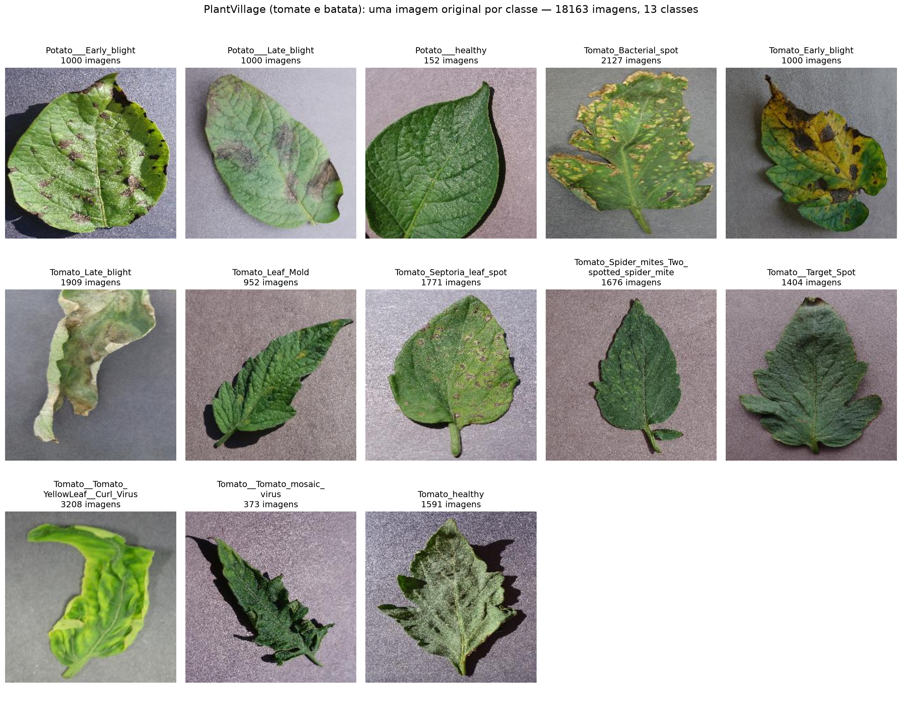

[← voltar ao README](../README.md)

# Dados

- [PlantVillage Dataset (Kaggle)](https://www.kaggle.com/datasets/emmarex/plantdisease)

Utilizamos um subconjunto do dataset, com as classes de **tomate** e
**batata** (13 classes no total).

## Formato e resolução

Resumo de todas as imagens de `data/`, gerado por `python src/data_overview.py`
([`reports/pi/dados/resumo_dados.csv`](../reports/pi/dados/resumo_dados.csv)): são
18.163 imagens em 13 classes, todas com **256x256 pixels**, em formato **JPEG**
(lido do cabeçalho do arquivo; as extensões variam entre `.JPG`, `.jpg` e
`.jpeg`) e modo de cor **RGB**. Um arquivo que não é imagem foi encontrado em
`data/` e é ignorado pelos scripts.

## Desbalanceamento

A maior classe (`Tomato__Tomato_YellowLeaf__Curl_Virus`, 3.208 imagens) tem
cerca de 21 vezes mais imagens que a menor (`Potato___healthy`, 152). O treino
da CNN compensa isso com `class_weight` balanceado e os SVMs com
`class_weight="balanced"` (ver [CNN](04_cnn.md) e
[Classificador híbrido](05_classificador_hibrido.md)).

## Split treino / validação / teste

Divisão estratificada 70/15/15 (seed 42) feita por `python src/split_dataset.py`,
registrada em `data_split/split_manifest.csv` e resumida em
[`reports/pi/dados/split_summary.csv`](../reports/pi/dados/split_summary.csv). O conjunto de teste
é fixo e nunca é usado no treino nem na escolha de hiperparâmetros.

| Classe | Treino | Validação | Teste | Total |
|---|---|---|---|---|
| Potato___Early_blight | 700 | 150 | 150 | 1000 |
| Potato___Late_blight | 700 | 150 | 150 | 1000 |
| Potato___healthy | 106 | 23 | 23 | 152 |
| Tomato_Bacterial_spot | 1489 | 319 | 319 | 2127 |
| Tomato_Early_blight | 700 | 150 | 150 | 1000 |
| Tomato_Late_blight | 1336 | 286 | 287 | 1909 |
| Tomato_Leaf_Mold | 666 | 143 | 143 | 952 |
| Tomato_Septoria_leaf_spot | 1240 | 265 | 266 | 1771 |
| Tomato_Spider_mites_Two_spotted_spider_mite | 1173 | 251 | 252 | 1676 |
| Tomato__Target_Spot | 983 | 211 | 210 | 1404 |
| Tomato__Tomato_YellowLeaf__Curl_Virus | 2246 | 481 | 481 | 3208 |
| Tomato__Tomato_mosaic_virus | 261 | 56 | 56 | 373 |
| Tomato_healthy | 1114 | 239 | 238 | 1591 |
| TOTAL | 12714 | 2724 | 2725 | 18163 |
