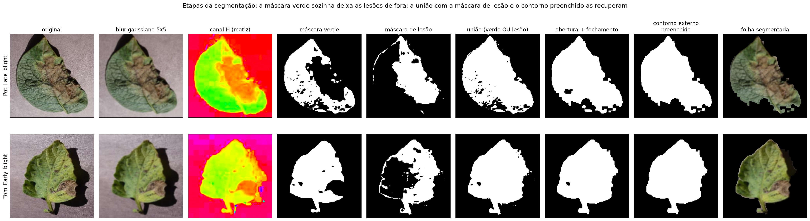
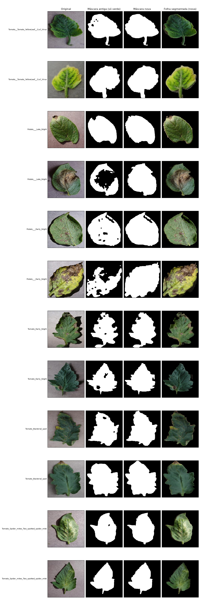
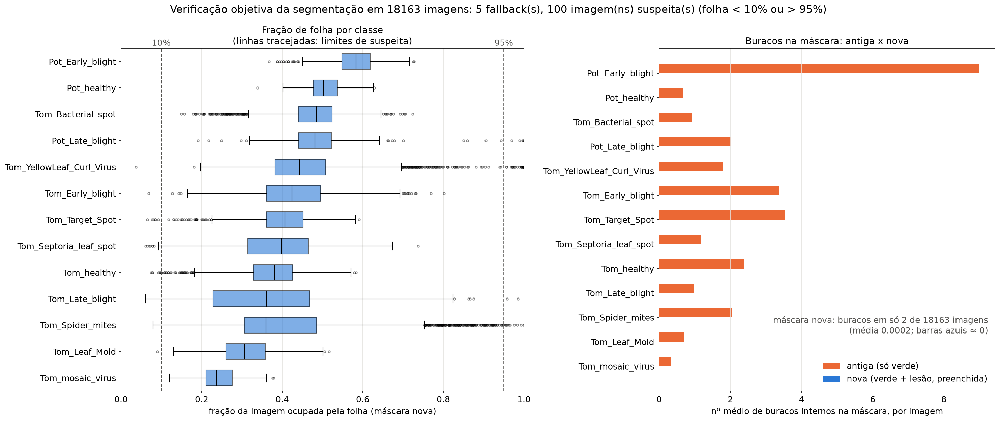
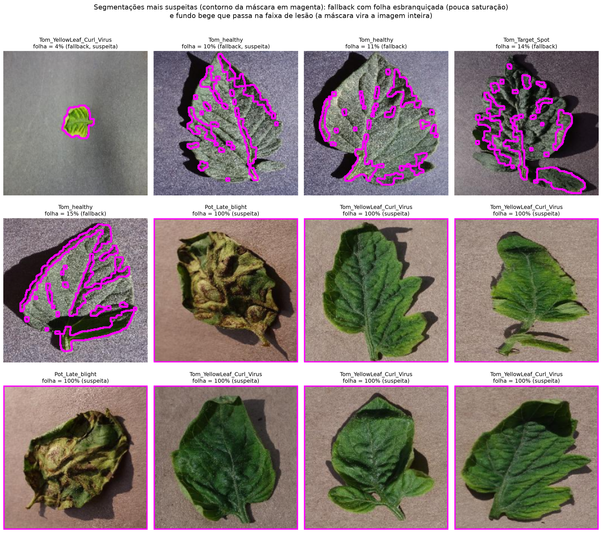

[← voltar ao README](../README.md)

# Pipeline de Processamento de Imagens e segmentação

O projeto tem como objetivo identificar, a partir de uma imagem de folha,
se a planta está saudável ou apresenta algum tipo de doença. O pipeline de
processamento de imagens segue as etapas abaixo (1 a 4 em
[`src/preprocessing.py`](../src/preprocessing.py); a 5 em [`src/features.py`](../src/features.py)):

1. **Leitura e redimensionamento**: cada imagem é carregada e padronizada
   para 224x224 pixels, garantindo uma entrada uniforme para as etapas
   seguintes.
2. **Suavização / remoção de ruído**: aplicação de um filtro Gaussian Blur
   (kernel 5x5), reduzindo ruídos de captura e pequenas imperfeições que
   poderiam atrapalhar a segmentação.
3. **Conversão de espaço de cor (BGR → HSV)**: o OpenCV lê as imagens em
   BGR; o espaço HSV separa informação de matiz (cor), saturação e brilho,
   o que facilita a segmentação por cor.
4. **Segmentação da folha**: a máscara é a união (`cv2.bitwise_or`) de
   duas faixas de cor em HSV (`cv2.inRange`): os tons de verde da folha e
   os tons de lesão (manchas marrons/amarelas, H ~8–35). Em seguida, são
   aplicadas operações morfológicas (abertura e fechamento) para limpar
   ruídos. Por fim, com `cv2.findContours` mantemos apenas o maior
   contorno externo (a folha) e o preenchemos por inteiro
   (`cv2.drawContours` com `cv2.FILLED`), de modo que tudo o que está
   dentro da folha entra na máscara e o fundo é removido. Se nenhum
   contorno for encontrado ou se o maior ocupar menos de 5% da imagem,
   usa-se a máscara de cor como fallback.
   - **Motivo da mudança**: a versão anterior usava apenas a máscara de
     verde, e as lesões das doenças (que não são verdes) ficavam fora
     dela, virando "buracos" pretos na imagem segmentada — ou seja, o
     sintoma da doença era justamente o que estava sendo apagado. A
     comparação entre as duas abordagens pode ser gerada com
     `python src/segmentation_report.py --comparacao` (salva em
     [`reports/pi/segmentacao/segmentation_comparison.png`](../reports/pi/segmentacao/segmentation_comparison.png)).
   - **Escolha dos limiares da máscara de lesão**: o matiz (H ~8–35) foi
     fixado e testamos os mínimos de saturação (S) e brilho (V) nas mesmas
     12 imagens (seed 42), com
     `python src/segmentation_report.py --comparacao --s <S> --v <V> --out <arquivo>`:

     | S | V | Lesões na borda | Vazamento de fundo | Imagem |
     |---|---|---|---|---|
     | 40 | 30 | Lesões escuras da borda cortadas | Não | [`reports/pi/segmentacao/estudo_limiares/segmentation_S40_V30.png`](../reports/pi/segmentacao/estudo_limiares/segmentation_S40_V30.png) |
     | 25 | 20 | Recuperadas | Sim: o fundo bege/cinza tem matiz na faixa do marrom, e só a saturação separa os dois | [`reports/pi/segmentacao/estudo_limiares/segmentation_S25_V20.png`](../reports/pi/segmentacao/estudo_limiares/segmentation_S25_V20.png) |
     | **40** | **20** | **Recuperadas (escolhido)** | **Não** | [`reports/pi/segmentacao/segmentation_comparison.png`](../reports/pi/segmentacao/segmentation_comparison.png) |
     | 35 | 20 | Recuperadas | Sombra/fundo começam a entrar | [`reports/pi/segmentacao/estudo_limiares/segmentation_S35_V20.png`](../reports/pi/segmentacao/estudo_limiares/segmentation_S35_V20.png) |

   - **Limitação conhecida**: lesões de borda com saturação tão baixa
     quanto a do fundo (ex.: o recorte em uma das imagens de
     `Potato___Early_blight`) não são separáveis apenas por limiar de HSV.
     Uma melhoria futura seria segmentar a folha com GrabCut ou com um
     modelo de segmentação (ex.: U-Net).
   - **Verificação objetiva** (`python src/segmentation_report.py`, em
     todas as 18.163 imagens; resultados em [`reports/pi/segmentacao/`](../reports/pi/segmentacao/)):
     - As etapas da segmentação estão em `etapas_segmentacao.png`. O
       script confere que a máscara final reimplementada para a figura é
       idêntica à do `segment_leaf` em todas as imagens.
     - **Buracos**: a máscara antiga (só verde) teria buracos internos em
       10.604 imagens (média de 2,15 por imagem), em geral nas lesões. Na
       máscara nova, só 2 imagens têm algum buraco.
     - **Fração da imagem ocupada pela folha**: mediana de 0,42. O
       fallback (maior contorno < 5% da imagem) foi acionado em 5 imagens.
     - **Casos suspeitos**: 100 imagens (0,6%), sendo 49 com folha < 10% da
       imagem e 51 com folha > 95%. As 12 mais suspeitas estão em
       `casos_suspeitos.png`. Inspecionando os casos, há dois tipos de
       falha real:
       - **Fundo que vaza** (folha > 95%): fundos bege/rosados com
         saturação ≥ 40 passam na faixa de lesão, e o contorno preenchido
         engole a imagem inteira. Concentrado em
         `Tomato__Tomato_YellowLeaf__Curl_Virus` (32) e
         `Tomato_Spider_mites_Two_spotted_spider_mite` (11).
       - **Folhas esbranquiçadas** (pouca saturação): a máscara verde se
         fragmenta e só um pedaço da folha é mantido. É a causa de 4 dos 5
         fallbacks.
       - Nem todo caso com folha < 10% é falha: numa amostra de 8, cerca de
         metade eram folhas realmente pequenas na foto, segmentadas
         corretamente.
     - Os dois tipos de falha reforçam a melhoria futura citada acima
       (GrabCut ou U-Net).
5. **Extração de features clássicas** (complementar, em [`src/features.py`](../src/features.py)):
   147 descritores de cor, proporção de lesão e textura (GLCM e LBP),
   calculados só nos pixels da folha (máscara da segmentação). Essa etapa
   foi separada do `preprocessing.py` (que só segmenta) e é usada pelo
   classificador híbrido (ver [Classificador híbrido](05_classificador_hibrido.md)).

## Figuras

Etapas da segmentação (`python src/segmentation_report.py`):

Máscara antiga x nova (`python src/segmentation_report.py --comparacao`):

Verificação objetiva em todas as imagens:

## Histograma de intensidade (material da P1)

O script `src/histogram_analysis.py` gera
[`reports/pi/p1_histograma/histograma_exemplo.png`](../reports/pi/p1_histograma/histograma_exemplo.png), que
compara o histograma de intensidade de uma imagem antes e depois de uma
normalização min-max. É material da P1, mantido só como registro: essa
normalização **não faz parte do pipeline final** (as etapas do
`preprocessing.py` são as 1 a 4 acima, sem normalização de intensidade).

A demonstração ao vivo destas etapas, em uma imagem, é feita com `python src/demo_pi.py` (ver [Como reproduzir](07_como_reproduzir.md#demonstração-do-processamento-de-imagens-demo_pipy)).
