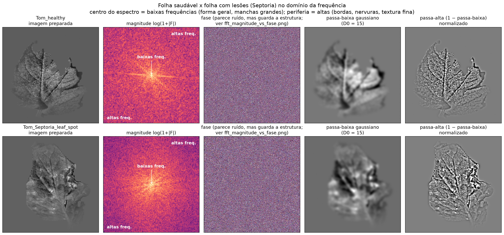
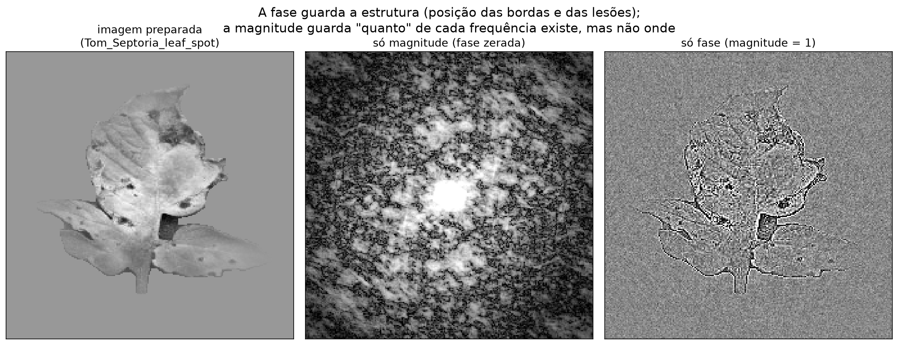
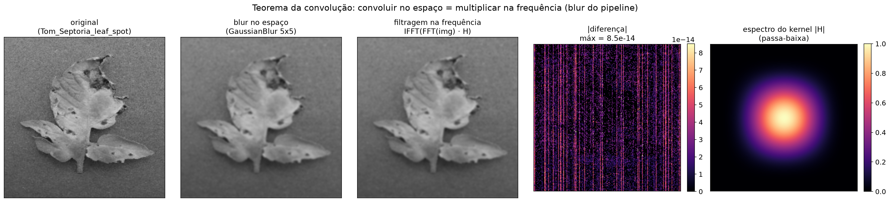
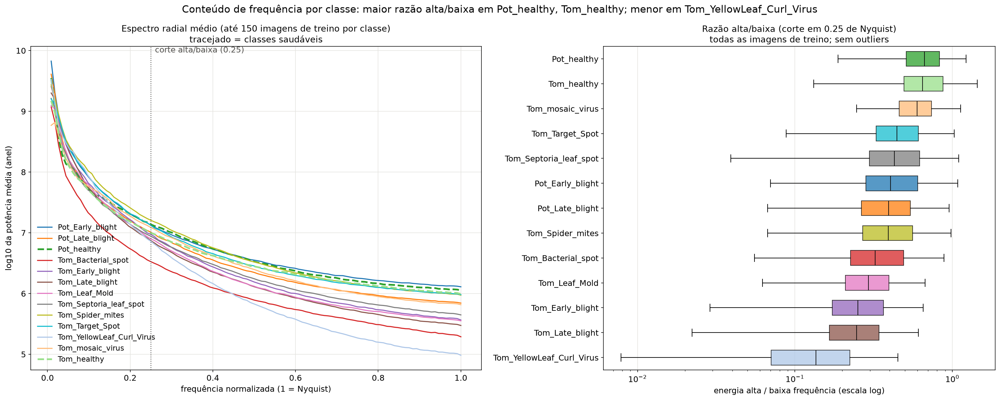
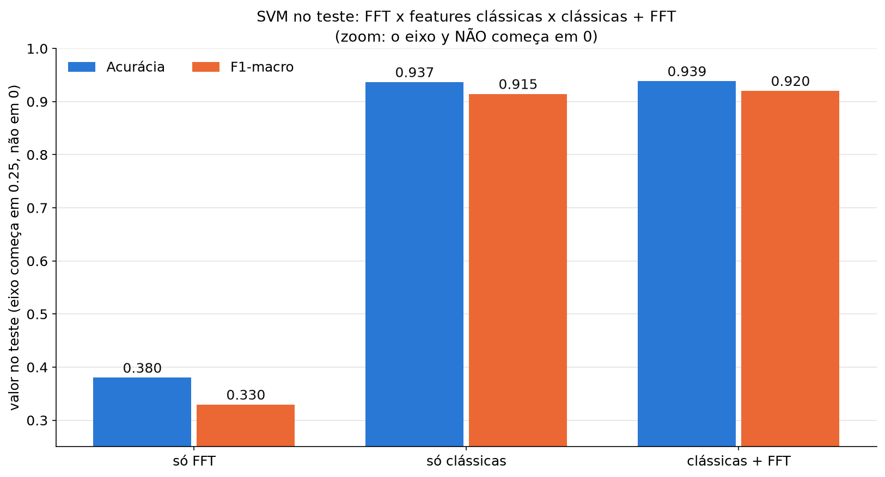

[← voltar ao README](../README.md)

# FFT (domínio da frequência)

<!-- Ao editar este arquivo, atualize também docs_EN/03_fft.md -->

**🇧🇷 Português** | [🇺🇸 English](docs_EN/03_fft.md)

Implementado em [`src/processamento_imagens/fft_analysis.py`](../src/processamento_imagens/fft_analysis.py), com figuras em [`reports/pi/fft/`](../reports/pi/fft/).

**Preparação de cada imagem**:
1. Tom de cinza da imagem original 224x224, antes do blur, porque o blur
   apagaria as altas frequências.
2. Fundo preenchido com a média de cinza da folha. O degrau entre a folha
   e o fundo preto criaria um "+" enorme no espectro.
3. Subtração da média, para o termo DC não dominar as baixas frequências.
4. Janela de Hann 2D, que reduz o vazamento espectral causado pelas bordas
   da imagem.
5. `np.fft.fft2` + `fftshift`.

**Baixas x altas frequências**: o centro do espectro (baixas frequências)
representa a forma geral da folha e as variações lentas de tom, como manchas
grandes. A periferia (altas frequências) representa bordas, nervuras e
textura fina. Em `fft_saudavel_vs_doente.png`, o passa-baixa gaussiano
(D0 = 15) deixa só a silhueta e as manchas grandes, e o passa-alta realça
bordas, nervuras e o contorno das lesões. No espectro radial por classe
(`espectro_radial_por_classe.png`), as duas classes **saudáveis** têm a
maior razão de energia alta/baixa frequência, e
`Tomato__Tomato_YellowLeaf__Curl_Virus` a menor. A energia em alta
frequência vem principalmente da textura fina e nítida da folha; as lesões
são manchas de tamanho médio e não aumentam essa razão.

**Magnitude x fase** (`fft_magnitude_vs_fase.png`): a reconstrução só com a
fase mantém a estrutura da folha (posição das bordas e das lesões). A
reconstrução só com a magnitude perde a estrutura: a magnitude diz "quanto"
de cada frequência existe, mas não onde.

**Teorema da convolução com o blur do pipeline**
(`blur_espaco_vs_frequencia.png`): aplicar o `GaussianBlur` 5x5 do
`preprocessing.py` no espaço, com borda circular, dá o mesmo resultado que
multiplicar a FFT da imagem pela FFT do kernel (com zero-padding para
224x224). O erro máximo absoluto é de 8,5e-14 níveis de cinza, ou seja,
erro de arredondamento. A FFT do kernel mostra que o blur é um filtro
passa-baixa.

**FFT como descritor de textura**: para todas as imagens, 11 descritores do
espectro de potência (energia normalizada em 8 faixas radiais espaçadas em
log, razão alta/baixa, centroide espectral e entropia espectral), em
`features_cache/fft_features.csv`. SVM (RBF, C = 10, `class_weight`
balanceado), treinado só no treino e avaliado no teste:

| Features | Nº | Acurácia | F1-macro |
|---|---|---|---|
| Só FFT | 11 | 0.380 | 0.330 |
| Só clássicas | 147 | 0.937 | 0.915 |
| Clássicas + FFT | 158 | 0.939 | 0.920 |

Sozinha, a FFT radial discrimina mal as 13 classes: ela resume a textura
em poucos números e não tem informação de cor. Somada às features
clássicas, o ganho é **pequeno** (+0.002 de acurácia, cerca de 5 imagens de
2.725, e +0.006 de F1-macro), então não a incorporamos ao classificador
híbrido. O resultado "só clássicas" difere um pouco do `SVM_classicas` do
classificador híbrido porque aqui os hiperparâmetros são fixos (C = 10),
sem a busca na validação.

As figuras e os descritores são gerados só com o bloco de Processamento de
Imagens. A comparação com SVM acima usa também as features clássicas do bloco de
IA (`features_cache/handcrafted.csv`); se esse arquivo não existir, o
`fft_analysis.py` pula essa comparação com um aviso.

## Figuras

A demonstração ao vivo destas etapas, em uma imagem, é feita com `python src/demo_pi.py` (ver [Como reproduzir](07_como_reproduzir.md#demonstração-do-processamento-de-imagens-demo_pipy)).
