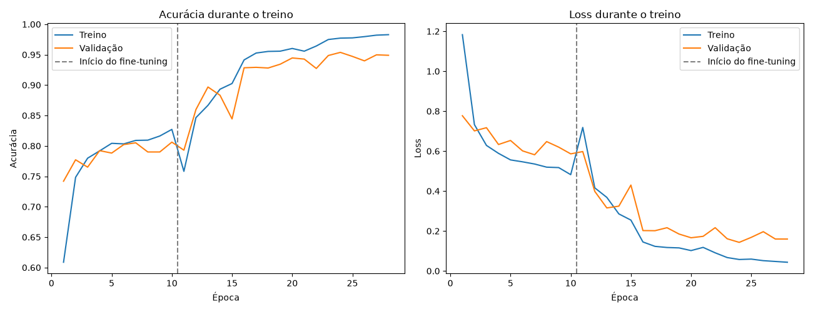
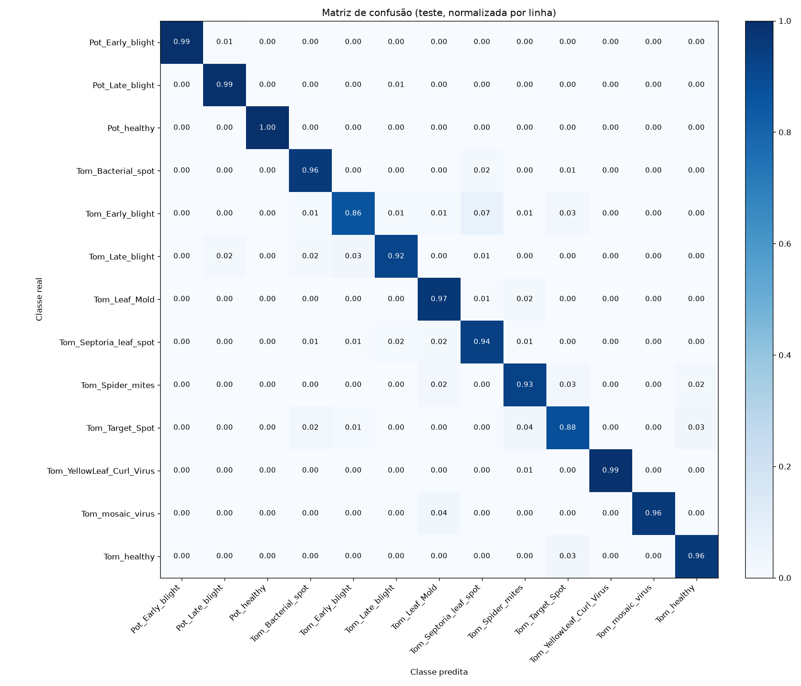

[← voltar ao README](../README.md)

# CNN (integração com IA)

<!-- Ao editar este arquivo, atualize também docs_EN/04_cnn.md -->

**🇧🇷 Português** | [🇺🇸 English](docs_EN/04_cnn.md)

A saída do pipeline de processamento de imagens (imagens segmentadas)
alimenta um modelo de classificação baseado em **transfer learning**
(implementado em [`src/ia/cnn/train_model.py`](../src/ia/cnn/train_model.py)). O pipeline completo do projeto é:

```
Imagem bruta
   → Pré-processamento (resize, blur, HSV)
   → Segmentação da folha (remoção de fundo)
   → [ramo IA]     → Data augmentation (flip, rotação, zoom, contraste; só no treino)
                    → Modelo MobileNetV2 (pré-treinada em ImageNet)
                    → Camada de classificação customizada (GlobalAveragePooling + Dropout + Dense)
                    → Fine-tuning das últimas camadas da base
   → Predição da classe (saudável ou tipo de doença)
```

Etapas do treino:

1. **Carregamento**: as imagens de `data_processed/` são divididas por
   [`src/dados/split_dataset.py`](../src/dados/split_dataset.py) em 70% treino / 15% validação / 15% teste
   (estratificado por classe, seed 42), com a divisão registrada em
   `data_split/split_manifest.csv`. A validação é usada só no early
   stopping; as métricas finais são calculadas no teste, que nunca entra
   no treino.
2. **Data augmentation**: flip horizontal e vertical, rotação, zoom e
   contraste aleatórios, aplicados por camadas dentro do próprio modelo.
   Elas só atuam no treino; na validação, no teste e na demo a imagem
   passa sem alteração.
3. **Class weight balanceado**: o dataset é desbalanceado (~21x entre
   `Tomato__Tomato_YellowLeaf__Curl_Virus`, com 3208 imagens, e
   `Potato___healthy`, com 152). Cada classe recebe um peso inversamente
   proporcional à sua frequência no treino (`compute_class_weight("balanced")`),
   para que as classes pequenas não sejam ignoradas.
4. **Transfer learning**: a MobileNetV2 é carregada com pesos do ImageNet
   e inicialmente congelada; apenas a camada de classificação (13 classes)
   é treinada, por até 10 épocas com learning rate 1e-3.
5. **Fine-tuning**: as últimas 50 camadas da MobileNetV2 são descongeladas
   e re-treinadas por até 20 épocas com learning rate 1e-4, permitindo que
   o modelo se especialize nas características específicas das doenças de
   folhas. As camadas **BatchNormalization continuam congeladas**: se
   fossem destravadas, passariam a atualizar suas estatísticas com os
   batches do treino, o que desestabilizou o modelo no início do
   fine-tuning na rodada anterior ([`reports/ia/historico/cnn_run1/`](../reports/ia/historico/cnn_run1/)).
6. **Early stopping e ReduceLROnPlateau**: em cada etapa, o treino é
   interrompido quando a `val_loss` (loss de validação) para de melhorar
   por 4 épocas, e o learning rate é multiplicado por 0.3 sempre que ela
   fica 2 épocas sem melhorar (mínimo 1e-6). Ao fim de cada etapa, o
   modelo fica com os pesos da época de menor `val_loss`, mesmo que a
   etapa chegue ao limite de épocas sem o early stopping disparar.

## Resultados da CNN

Métricas no **conjunto de teste**: 2.725 imagens que nunca foram usadas no
treino nem na seleção de modelo (a validação serve só para o early stopping e
para a redução do learning rate).

**Evolução do modelo**

| | Baseline v1 | Rodada 1 | Rodada 2 (atual) |
|---|---|---|---|
| Medido em | validação (3.632 imagens) | teste (2.725 imagens) | teste (2.725 imagens) |
| Acurácia | 0.88 | 0.815 | **0.949** |
| F1-macro | 0.86 | 0.796 | **0.950** |
| Recall `Tomato_Early_blight` | 0.59 | 0.51 | **0.86** |
| Recall `Tomato__Target_Spot` | 0.73 | 0.64 | **0.88** |
| Recall `Tomato_Late_blight` | 0.87 | 0.62 | **0.92** |

- **Baseline v1**: segmentação antiga (máscara só de verde, que apagava as
  lesões), divisão 80/20 sem conjunto de teste e métrica medida na própria
  validação usada no early stopping, por isso otimista e não comparável
  diretamente com as rodadas seguintes. O relatório do baseline só tem duas
  casas decimais.
- **Rodada 1**: segmentação corrigida, divisão 70/15/15 com teste separado,
  data augmentation e class weight balanceado. O fine-tuning, porém,
  desestabilizou o modelo porque as camadas BatchNormalization destravadas
  passaram a atualizar suas estatísticas: na primeira época do fine-tuning a
  loss de treino saltou de 0.53 para 1.40 (pico visível em
  [`reports/ia/historico/cnn_run1/training_history.png`](../reports/ia/historico/cnn_run1/training_history.png)).
- **Rodada 2**: BatchNormalization congelado no fine-tuning, 50 camadas
  destravadas, learning rate 1e-4 com ReduceLROnPlateau e até 20 épocas de
  fine-tuning. Na prática, a etapa 1 rodou 10 épocas (melhor: 7) e o
  fine-tuning 18 épocas (melhor: 14), com o learning rate reduzido até 2.7e-6.

Os recalls de `Tomato_Early_blight` e `Tomato__Target_Spot` continuam os mais
baixos entre essas classes: as duas doenças produzem manchas parecidas.

O relatório completo (precision/recall/F1 por classe), a matriz de confusão,
as métricas e o histórico de treino da CNN estão em [`reports/ia/cnn/`](../reports/ia/cnn/); os
resultados do classificador híbrido estão em [`reports/ia/hibrido/`](../reports/ia/hibrido/) (ver
[Resultados do classificador híbrido](05_classificador_hibrido.md#resultados-do-classificador-híbrido)).

## Figuras





A demonstração ao vivo, em uma imagem, é feita com `python src/demo_ia.py` (ver [Como reproduzir](07_como_reproduzir.md#demonstração-da-ia-demo_iapy)).
