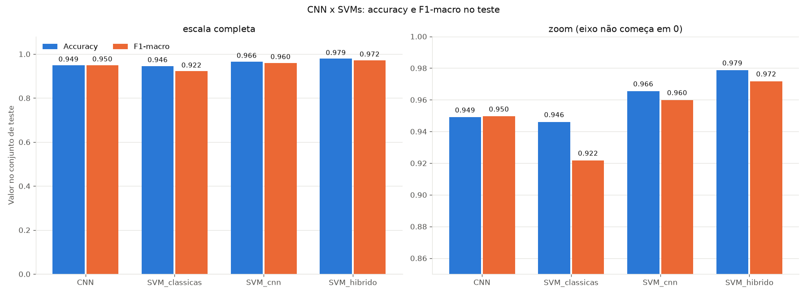
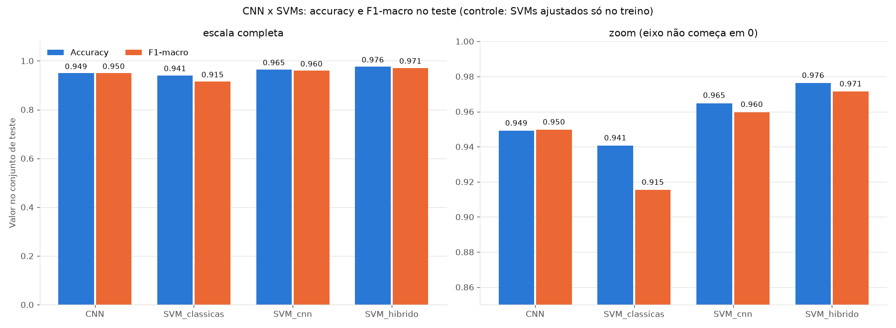
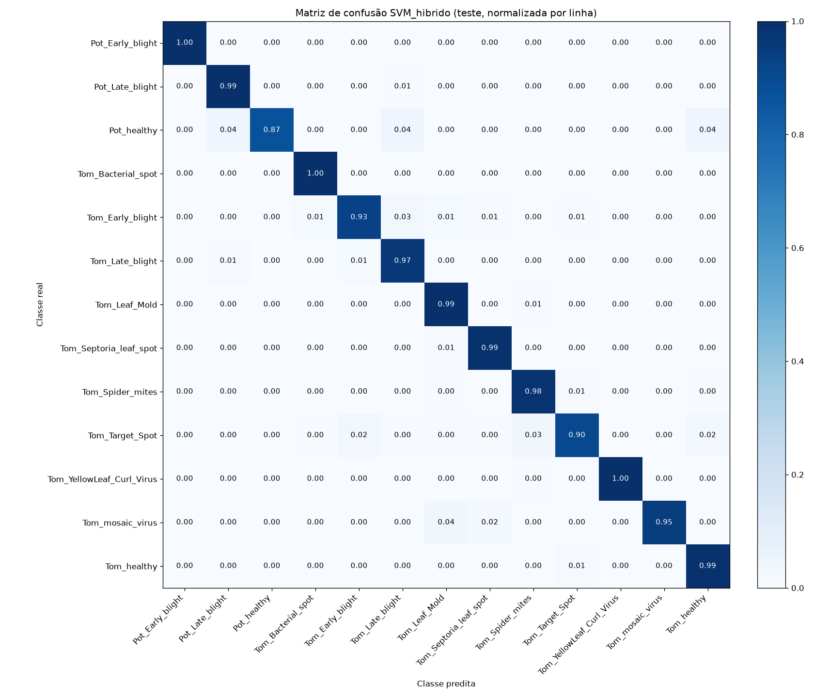

[← voltar ao README](../README.md)

# Classificador híbrido (CNN + features clássicas + SVM)

<!-- Ao editar este arquivo, atualize também docs_EN/05_hybrid_classifier.md -->

**🇧🇷 Português** | [🇺🇸 English](docs_EN/05_hybrid_classifier.md)

Além da CNN, o projeto treina um classificador **SVM** que combina dois tipos
de informação: os **embeddings** aprendidos pela CNN e **features clássicas**
de processamento de imagens. Ele é comparado com a própria CNN no mesmo
conjunto de teste.

```
split fixo (data_split/split_manifest.csv: treino / validação / teste)
   │
   ├─ imagem original ──→ segmentação (segment_image) ──→ features clássicas da folha (147)
   │                                                        → StandardScaler ─────────────┐
   │                                                                                      ├─→ SVM (RBF) → classe
   └─ imagem segmentada ─→ CNN treinada ─→ embedding GAP (1280)                            │
                                            → StandardScaler → PCA (64/128/256) ──────────┘
```

Implementação: [`src/processamento_imagens/features.py`](../src/processamento_imagens/features.py) (features), [`src/ia/hibrido/extract_features.py`](../src/ia/hibrido/extract_features.py)
(extrai e salva tudo em `features_cache/`) e [`src/ia/hibrido/hybrid_classifier.py`](../src/ia/hibrido/hybrid_classifier.py)
(treino, avaliação e comparativo).

**Features clássicas** (todas calculadas só nos pixels da folha, usando a
máscara da segmentação):

| Grupo | Nº | O que captura |
|---|---|---|
| Cor: histogramas H (32 bins), S (16), V (16) | 64 | distribuição de matiz, saturação e brilho da folha (amarelamento, manchas, palidez) |
| Cor: momentos (média, desvio, assimetria) em HSV e Lab | 18 | cor média da folha e quão espalhada/assimétrica ela é |
| Proporção de lesão | 1 | fração da folha nos tons de lesão (`LOWER_LESION`/`UPPER_LESION`): quanto da folha está manchada |
| Textura GLCM (32 níveis; distâncias 1, 2, 3; 0°/45°/90°/135°) | 36 | contraste, dissimilaridade, homogeneidade, energia, correlação e ASM; média e desvio entre os ângulos (invariante à rotação) |
| Textura LBP uniforme (P=8, R=1) e (P=16, R=2) | 28 | micro-padrões de textura (pontos, bordas, manchas finas) em duas escalas |

No GLCM, o fundo é codificado como nível 0 e a linha/coluna 0 da matriz é
descartada antes de calcular as propriedades, para que só pares de pixels da
folha contem.

Três SVMs são comparados com a CNN:

| Modelo | Entrada |
|---|---|
| `SVM_classicas` | só features clássicas |
| `SVM_cnn` | só embeddings da CNN (com PCA) |
| `SVM_hibrido` | embeddings (com PCA) + features clássicas |
| `CNN` | softmax da própria CNN (referência) |

Decisões de projeto:

- **Por que SVM com kernel RBF**: funciona bem com algumas centenas de
  features densas e padronizadas, separa as classes de forma não linear e,
  com `class_weight="balanced"`, compensa o desbalanceamento entre as classes.
- **Por que PCA no bloco da CNN**: os embeddings têm 1280 dimensões e as
  features clássicas, 147. Sem redução, a distância do kernel RBF seria
  dominada pelos embeddings e as features clássicas quase não pesariam. A PCA
  equilibra os dois blocos.
- **Por que escolher os hiperparâmetros na validação**: a CNN foi treinada
  nas imagens de treino, então os embeddings do treino ficam "fáceis demais".
  Uma validação cruzada dentro do treino superestimaria todos os candidatos e
  enviesaria a escolha. Por isso, o `GridSearchCV` usa um `PredefinedSplit`:
  ajusta no treino, mede o F1-macro na validação e, com os melhores
  hiperparâmetros (C, gamma e nº de componentes da PCA), reajusta em
  treino + validação. **O teste nunca é usado para treinar nem para escolher
  hiperparâmetros.**
- **Teste de McNemar**: compara dois classificadores nas mesmas imagens de
  teste, olhando só os casos em que eles discordam (um acerta e o outro erra).
  Se a diferença fosse acaso, esses casos se dividiriam meio a meio; o teste
  binomial exato dá o p-valor (p < 0,05 indica diferença estatisticamente
  significativa). É aplicado entre `CNN` e `SVM_hibrido` e entre `SVM_cnn` e
  `SVM_hibrido`.

Saídas em [`reports/ia/hibrido/`](../reports/ia/hibrido/): métricas e relatório por classe de cada modelo,
resultados do grid search, matriz de confusão do `SVM_hibrido`,
`comparativo.csv`/`comparativo.png` e `mcnemar.txt`. O melhor pipeline
híbrido fica em `models/svm_hybrid.joblib`.

## Resultados do classificador híbrido

Todos os modelos são avaliados no mesmo conjunto de teste (2.725 imagens).

**Protocolo principal** (hiperparâmetros escolhidos na validação; SVMs
reajustados em treino + validação, 15.438 imagens):

| Modelo | Acurácia | F1-macro | F1-weighted |
|---|---|---|---|
| CNN | 0.949 | 0.950 | 0.949 |
| SVM_classicas | 0.946 | 0.922 | 0.946 |
| SVM_cnn | 0.966 | 0.960 | 0.965 |
| **SVM_hibrido** | **0.979** | **0.972** | **0.979** |

**Controle: SVMs ajustados só no treino.** No protocolo principal, os SVMs
usam ~21% a mais de dados que a CNN (15.438 contra 12.714 imagens; a CNN só
usou a validação para o early stopping). Para separar o efeito da fusão do
efeito desses dados extras, o controle (`python -m ia.hibrido.hybrid_classifier
--control-train-only`) reusa os mesmos hiperparâmetros e treina os SVMs só nas
12.714 imagens de treino:

| Modelo | Acurácia | F1-macro | F1-weighted |
|---|---|---|---|
| CNN | 0.949 | 0.950 | 0.949 |
| SVM_classicas | 0.941 | 0.915 | 0.940 |
| SVM_cnn | 0.965 | 0.960 | 0.965 |
| **SVM_hibrido** | **0.976** | **0.971** | **0.976** |

**Teste de McNemar** (casos em que só um dos dois modelos acerta):

| Protocolo | Par (A x B) | Casos discordantes | Só A acerta | Só B acerta | p-valor |
|---|---|---|---|---|---|
| Principal | CNN x SVM_hibrido | 111 | 15 | 96 | 1.2e-15 |
| Principal | SVM_cnn x SVM_hibrido | 52 | 8 | 44 | 4.0e-07 |
| Controle | CNN x SVM_hibrido | 102 | 14 | 88 | 2.8e-14 |
| Controle | SVM_cnn x SVM_hibrido | 43 | 6 | 37 | 1.6e-06 |

Em todos os pares o `SVM_hibrido` acerta mais nos casos discordantes, com
p < 0,05.

**Interpretação** (com base no controle, em que todos os modelos aprendem só
com o treino):

- **Ganho das features clássicas** (`SVM_cnn` x `SVM_hibrido`: mesmos
  embeddings, mesmo protocolo, só muda a presença das features clássicas): o
  F1-macro sobe de 0.960 para 0.971 e a acurácia de 0.965 para 0.976. Nos 43
  casos em que os dois discordam, o híbrido acerta 37 (p = 1.6e-06). As
  features clássicas trazem informação que os embeddings sozinhos não têm.
- **CNN x SVM_hibrido**: a vantagem se mantém no controle. A acurácia do
  híbrido cai só de 0.979 para 0.976 sem os dados de validação, e continua
  acima da CNN (0.949), com 88 contra 14 casos discordantes (p = 2.8e-14).
  Portanto, a vantagem não vem dos ~21% de dados extras. Parte dela vem de
  trocar a cabeça softmax da CNN por um SVM sobre os mesmos embeddings
  (`SVM_cnn` já fica em 0.965 de acurácia, contra 0.949 da CNN; esse par não
  passou por McNemar), e o restante das features clássicas (item anterior).
- **Por que as clássicas sozinhas têm F1-macro menor** (0.922 contra 0.946 de
  acurácia no protocolo principal): o F1-macro dá o mesmo peso a todas as
  classes, e `Potato___healthy` tem só 106 imagens de treino (23 no teste).
  Nessa classe, o `SVM_classicas` tem recall de 0.52 (F1 0.67); sem ela, o
  F1-macro das outras 12 classes seria cerca de 0.94. No híbrido, os embeddings da CNN
  recuperam boa parte dessa classe: recall de 0.87 no protocolo principal e
  0.91 no controle (F1 0.93 e 0.95). Ainda fica abaixo da CNN, que acerta as 23
  imagens (recall 1.00). Com só 23 imagens, cada imagem equivale a ~0.04 de
  recall.

**Melhores hiperparâmetros** (escolhidos pelo F1-macro na validação):

| Modelo | C | gamma | Componentes da PCA | F1-macro na validação |
|---|---|---|---|---|
| SVM_classicas | 100 | 0.01 | — | 0.924 |
| SVM_cnn | 10 | scale | 256 | 0.968 |
| SVM_hibrido | 10 | scale | 128 | 0.973 |

Gráficos: [`reports/ia/hibrido/comparativo.png`](../reports/ia/hibrido/comparativo.png) (protocolo principal) e
[`reports/ia/hibrido/controle_refit_treino/comparativo.png`](../reports/ia/hibrido/controle_refit_treino/comparativo.png) (controle), cada um com
um painel em escala completa e um painel com zoom (eixo começando em 0.85),
onde as diferenças entre os modelos ficam visíveis.

**Limitação**: o PlantVillage é formado por fotos de laboratório (fundo
uniforme, uma folha isolada, iluminação controlada). Os resultados de todos os
modelos, CNN e SVMs, podem não se manter em fotos de campo, com fundo
complexo, várias folhas e iluminação variável (*domain shift*). Validar em
imagens de campo é necessário antes de qualquer uso prático.

## Figuras







A demonstração ao vivo, em uma imagem, é feita com `python src/demo_ia.py` (ver [Como reproduzir](07_como_reproduzir.md#demonstração-da-ia-demo_iapy)).
